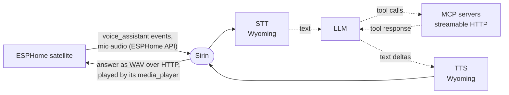

# Sirin

A voice pipeline for ESPHome satellites that keeps Home Assistant out of the voice path. It connects to the device over the ESPHome native API, the same way HA does, and answers its voice_assistant events itself.



## Running

```sh
pip install -e .
curl -fL --create-dirs -o models/silero_vad.onnx \
  https://raw.githubusercontent.com/snakers4/silero-vad/v6.2.3/src/silero_vad/data/silero_vad.onnx
echo "1a153a22f4509e292a94e67d6f9b85e8deb25b4988682b7e174c65279d8788e3  models/silero_vad.onnx" | sha256sum -c
sirin   # -v logs protocol events
```

The Docker image already contains the VAD model and the voice models. To recognize voices without Docker, download the voice models too; without them Sirin runs as before and logs that voices are not recognized:

```sh
voxlock=https://huggingface.co/arbazsiddiqui/voxlock/resolve/2413b292bc2c337bfc19a9802aaf3e011e68e9c4/onnx/v2
curl -fL --create-dirs -o models/voices/speaker.onnx \
  https://github.com/k2-fsa/sherpa-onnx/releases/download/speaker-recongition-models/wespeaker_en_voxceleb_resnet34_LM.onnx
curl -fL -o models/voices/enroll.onnx $voxlock/enroll.onnx
curl -fL -o models/voices/chunk.onnx $voxlock/chunk_int8.onnx
sha256sum -c <<EOF
e9848563da86f263117134dfd7ad63c92355b37de492b55e325400c9d9c39012  models/voices/speaker.onnx
81f305c9b7a32f13d1401f53bb4c6301826a607c9e807e60912f36ef1b9fae29  models/voices/enroll.onnx
c50ffdc8d723fd4f91cb08889f3d0143491f95967b705f35c444a0b4afe88172  models/voices/chunk.onnx
EOF
```

Or with Docker:

```sh
docker compose up -d --build
```

The compose file publishes port 8765 from a bridge network, where Sirin cannot see the address satellites reach it at, so set `SIRIN_PUBLIC_URL=http://<host LAN address>:8765` in `.env`; compose refuses to start without it. Settings are kept in `./data`. CI publishes a multi-arch image (amd64, arm64) to `ghcr.io/<owner>/sirin`, which the compose file pulls unless you pass `--build`.

Then open `http://<host>:8765/` and log in. At the first start Sirin creates the account `admin` and writes its
generated password to the log (`docker compose logs sirin`); change it with **Password** at the top of the page. A
forgotten password is replaced with `sirin --reset-password <login>` (in the container:
`docker compose exec sirin sirin --reset-password admin`). The admin adds people in the **People** card; a member can
log in and change their own password, and only an admin sees and edits the settings. The satellites need no login.

Fill in devices, STT, TTS, LLM and MCP servers. Each block has a **Test** button: it checks the connection with the unsaved values and fills suggestions (TTS voices, ASR languages, LLM models). Settings are stored in
the SQLite database `data/sirin.db` and applied without a restart. The JSON files of older versions (`settings.json`, `reminders.json`, `oauth/`) are not
read: configure a new install from the page.

Environment variables (or `.env`):

| Variable                    | Default                                                               | Purpose                                                                      |
|-----------------------------|-----------------------------------------------------------------------|------------------------------------------------------------------------------|
| `SIRIN_PUBLIC_URL`          | this host's address on the route to each satellite, with `SIRIN_PORT` | Base URL satellites download answers from; set it only behind a proxy or NAT |
| `SIRIN_HOST` / `SIRIN_PORT` | `0.0.0.0` / `8765`                                                    | HTTP server address                                                          |
| `SIRIN_AUDIO_TTL_S`         | `300`                                                                 | How long a finished answer stays downloadable                                |
| `SIRIN_DATA_DIR`            | `data`                                                                | Where the settings page stores its settings                                  |
| `SIRIN_VAD_MODEL`           | `models/silero_vad.onnx`                                              | Silero VAD ONNX model file                                                   |
| `SIRIN_VOICE_MODELS`        | `models/voices`                                                       | Directory with `speaker.onnx`, `enroll.onnx` and `chunk.onnx`; voices are recognized when it exists |

The settings page has no login. Keep the port reachable only from a trusted network.

MCP servers can use OAuth: turn on `oauth`, save, and press **Authorize**. The provider's login opens in a new tab and returns to `/oauth/callback` at the address you opened the settings page with. Tokens are kept in the database and refreshed automatically. The server must be saved under its current URL before you authorize it; changing its URL drops its tokens.

## Device requirements

- ESPHome with `voice_assistant` and audio over the API (any recent firmware).
- A `media_player` on the device: the answer is played from a URL on this service.
- For reminders, firmware with `voice_assistant` announce support (the `ANNOUNCE` feature flag).
- Only one client can hold the voice subscription. If the device is also added to HA, disable its Assist pipeline in HA or remove the device from the ESPHome integration.

## How it works

Every stage streams:

- **mic → STT.** Chunks go to the Wyoming ASR as they arrive. The server decides where the utterance ends: the device streams until the server sends `STT_VAD_END`. End-of-utterance detection is Home Assistant's segmenter on top of the Silero VAD model (`SIRIN_VAD_MODEL`); tune it with `vad.*` on the settings page.
- **LLM → TTS.** The pydantic-ai agent yields text deltas, including what the model says between tool calls. If the TTS server accepts streaming input (`supports_synthesize_streaming`), the deltas go straight to it; otherwise the text is split into sentences and each one is synthesized as soon as it is complete.
- **TTS → device.** The answer URL is sent in `RUN_START`, and `INTENT_PROGRESS
  tts_start_streaming=1` follows the first audio. The device downloads the WAV while it is still being synthesized.

If the model fails (unreachable, timeout, too many tool rounds), the device says `llm.error_reply` instead of the answer; write it in the language you speak. With an empty `error_reply` the device gets an error event, as it does for STT and TTS failures.

When the answer ends with a question, the device listens again right after it, without the wake word (`continue_conversation`, the same rule Home Assistant uses). If nobody replies, the model is told that the user did not answer and decides what to say or do; the device does not listen again after that turn. To stop a model that ends every answer with a question, say so in the system prompt.

Dialog history is kept per device `conversation_id` for `conversation_ttl_s` seconds. MCP tools are exposed to the LLM with a `<server>_` prefix. A server that is down or loses its connection is skipped and tried again every few seconds, up to once a minute, until it answers.

### Voices

With the voice models in place, the agent has the tools `remember_voice`, `forget_voice` and `known_voices`. Say "remember my voice, I am Anna" in a phrase with at least 3 seconds of speech; if it was shorter, the assistant asks for a longer one. Voices are kept in `data/voices/`: `voices.json` with the names and the embeddings that tell who speaks, and for each voice a WAV file with the 3-second sample that the isolation network needs. You can listen to a sample to check what was recorded.

For each utterance Sirin compares the first 1.5 seconds of speech with the remembered voices. If it is one of them, the user's turn reaches the LLM tagged with the name (`[Voice: Anna] ...`, or `[Voice: not recognized]` for any other voice), and from that speech on the audio goes through a target-speaker network (VoxLock) that keeps only that voice. Each isolated stretch of speech is then compared with the voice again and muted when it is somebody else, so another person or a TV that talks on after the command neither adds words to it nor keeps the device listening. A voice that is not remembered is recognized as before, unchanged.

Limits:

- The audio starts after the wake word, so the voice is taken from the first speech after it, not from the wake word itself.
- A command shorter than about a second is often too short to tell the voice; it is then recognized unchanged.
- If another voice is as loud as the speaker and talks at the same time, the network can keep the wrong one. That stretch is muted and the command is lost or cut.
- It is a convenience, not access control: a recording of a voice passes as that voice.
- Isolation takes about a quarter of one CPU core while a remembered voice speaks.

### History

Every utterance is kept as one turn: the device, what was recognized, the answer, the tool calls with their results,
the time each stage took, an error if there was one, and how similar the voice was to the closest remembered one. The
**History** tab shows them newest first, filtered by device and day, and adds new turns while you watch. Everybody who
can log in reads it; nobody can edit it. A wake word followed by no speech is not kept. Turns older than
`history.retention_days` (30 by default, on the settings page) are deleted, except a turn that set a reminder which is
still pending.

### Reminders

The agent has built-in tools `set_reminder`, `list_reminders` and `cancel_reminder` ("remind me to turn off the stove in 10 minutes", "remind me tomorrow to eat", "every day at 8 tell me the weather", "every hour from 8 to 10 until Friday remind me to drink water"). A recurring reminder has a cron schedule in local time (`0 8-10 * * *`) and repeats until it is canceled or until its end time. When it sets a reminder, the LLM writes a note to itself. At the due time the agent runs that note, with all its tools, and the device that set the reminder announces the answer. Reminders are kept in the database and survive a restart. If the device is offline, the reminder is retried every 30 s for up to an hour, then dropped. Reminders that came due while the service was down are dropped at startup; a recurring reminder skips that occurrence and stays scheduled for its next time.

Times are in the process's local time zone, the same one `now()` in the system prompt uses. In the container, set it with `TZ` (see `docker-compose.yml`).
