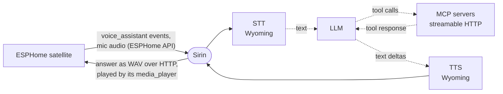

# Sirin

A voice pipeline for ESPHome satellites that keeps Home Assistant out of the voice path. It connects to the device over the ESPHome native API, the same way HA does, and answers its voice_assistant events itself.



## Running

```sh
pip install -e .
curl -fL --create-dirs -o models/silero_vad.onnx \
  https://raw.githubusercontent.com/snakers4/silero-vad/v6.2.3/src/silero_vad/data/silero_vad.onnx
echo "1a153a22f4509e292a94e67d6f9b85e8deb25b4988682b7e174c65279d8788e3  models/silero_vad.onnx" | sha256sum -c
sirin   # -v logs protocol events
```

The Docker image already contains the VAD model.

Or with Docker:

```sh
docker compose up -d --build
```

The compose file publishes port 8765 from a bridge network, where Sirin cannot see the address satellites reach it at, so set `SIRIN_PUBLIC_URL=http://<host LAN address>:8765` in `.env`; compose refuses to start without it. Settings are kept in `./data`. CI publishes a multi-arch image (amd64, arm64) to `ghcr.io/<owner>/sirin`, which the compose file pulls unless you pass `--build`.

Then open `http://<host>:8765/` and fill in devices, STT, TTS, LLM and MCP servers. Each block has a **Test** button: it checks the connection with the unsaved values and fills suggestions (TTS voices, ASR languages, LLM models). Settings are stored in
`data/settings.json` and applied without a restart.

Environment variables (or `.env`):

| Variable                    | Default                                                               | Purpose                                                                      |
|-----------------------------|-----------------------------------------------------------------------|------------------------------------------------------------------------------|
| `SIRIN_PUBLIC_URL`          | this host's address on the route to each satellite, with `SIRIN_PORT` | Base URL satellites download answers from; set it only behind a proxy or NAT |
| `SIRIN_HOST` / `SIRIN_PORT` | `0.0.0.0` / `8765`                                                    | HTTP server address                                                          |
| `SIRIN_AUDIO_TTL_S`         | `300`                                                                 | How long a finished answer stays downloadable                                |
| `SIRIN_DATA_DIR`            | `data`                                                                | Where the settings page stores its settings                                  |
| `SIRIN_VAD_MODEL`           | `models/silero_vad.onnx`                                              | Silero VAD ONNX model file                                                   |

The settings page has no login. Keep the port reachable only from a trusted network.

MCP servers can use OAuth: turn on `oauth`, save, and press **Authorize**. The provider's login opens in a new tab and returns to `/oauth/callback` at the address you opened the settings page with. Tokens are kept in `data/oauth/` and refreshed automatically.

## Device requirements

- ESPHome with `voice_assistant` and audio over the API (any recent firmware).
- A `media_player` on the device: the answer is played from a URL on this service.
- For reminders, firmware with `voice_assistant` announce support (the `ANNOUNCE` feature flag).
- Only one client can hold the voice subscription. If the device is also added to HA, disable its Assist pipeline in HA or remove the device from the ESPHome integration.

## How it works

Every stage streams:

- **mic → STT.** Chunks go to the Wyoming ASR as they arrive. The server decides where the utterance ends: the device streams until the server sends `STT_VAD_END`. End-of-utterance detection is Home Assistant's segmenter on top of the Silero VAD model (`SIRIN_VAD_MODEL`); tune it with `vad.*` on the settings page.
- **LLM → TTS.** The pydantic-ai agent yields text deltas, including what the model says between tool calls. If the TTS server accepts streaming input (`supports_synthesize_streaming`), the deltas go straight to it; otherwise the text is split into sentences and each one is synthesized as soon as it is complete.
- **TTS → device.** The answer URL is sent in `RUN_START`, and `INTENT_PROGRESS
  tts_start_streaming=1` follows the first audio. The device downloads the WAV while it is still being synthesized.

Dialog history is kept per device `conversation_id` for `conversation_ttl_s` seconds. MCP tools are exposed to the LLM with a `<server>_` prefix. A server that is down or loses its connection is skipped and tried again every few seconds, up to once a minute, until it answers.

### Reminders

The agent has built-in tools `set_reminder`, `list_reminders` and `cancel_reminder` ("remind me to turn off the stove in 10 minutes", "remind me tomorrow to eat", "every day at 8 tell me the weather", "every hour from 8 to 10 until Friday remind me to drink water"). A recurring reminder has a cron schedule in local time (`0 8-10 * * *`) and repeats until it is cancelled or until its end time. When it sets a reminder, the LLM writes a note to itself. At the due time the agent runs that note, with all its tools, and the device that set the reminder announces the answer. Reminders are kept in `data/reminders.json` and survive a restart. If the device is offline, the reminder is retried every 30 s for up to an hour, then dropped. Reminders that came due while the service was down are dropped at startup; a recurring reminder skips that occurrence and stays scheduled for its next time.

Times are in the process's local time zone, the same one `now()` in the system prompt uses. In the container, set it with `TZ` (see `docker-compose.yml`).
